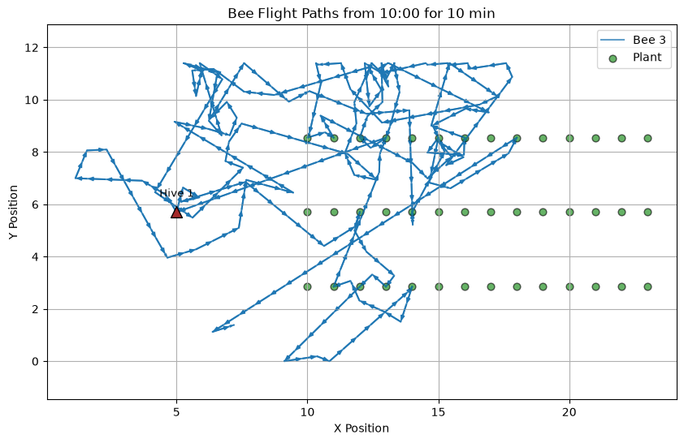
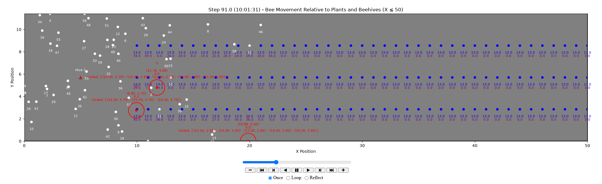
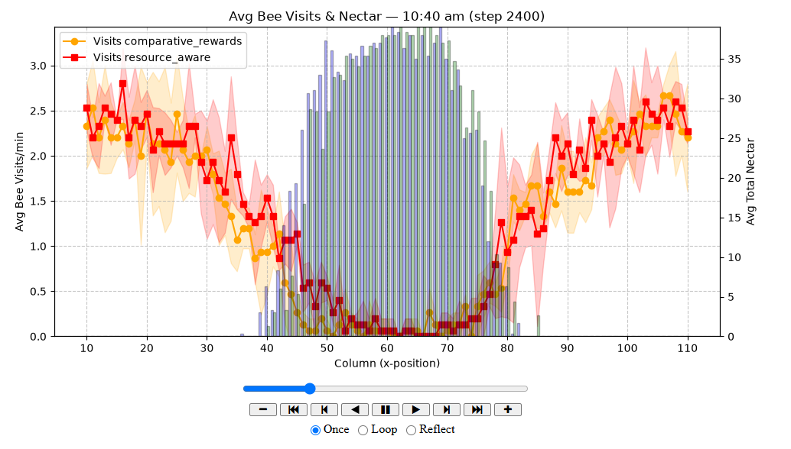

# Bee foraging in a polytunnel

An agent-based model of bees searching for and collecting nectar inside a
commercial-scale polytunnel. The project was developed during doctoral research
to study how local movement rules, flower information, and reward memory can
produce colony-level foraging patterns.

The repository is now organised as a reproducible research portfolio: the latest
model is separated from exploratory notebooks, while earlier development stages
remain available for provenance.

## What the simulation models

- A continuous `120 m × 11.4 m` environment with three rows of flowering plants.
- Two colonies positioned at opposite ends of the tunnel.
- Individual bee movement using short and long Lévy-flight steps.
- Nectar collection, depletion and optional replenishment.
- Flower scent marking, recent-flower memory and homing when a bee is full.
- Reproducible stochastic runs through Mesa's seeded random-number generator.

The current model compares three foraging strategies:

| Strategy | Decision rule |
| --- | --- |
| `resource_aware` | Uses recent flower rewards to alternate local search and longer relocation steps. |
| `comparative_rewards` | Compares the latest nectar reward with the previous successful visit. |
| `nearest_flower` | Selects the nearest available flower as a local-search baseline. |

## Visualisation and analysis

The notebooks complement the batch runner with an interactive workflow for
configuring experiments, validating agent behaviour, and comparing results.
They are intended both as research tools and as an inspectable record of how the
model was tested.

### Behaviour visualisation

[`notebooks/behavior_visualization.ipynb`](notebooks/behavior_visualization.ipynb)
supports validation at both the individual-agent and population levels. In
addition to the examples below, it includes diagnostics for turning angles and
jump distances.



*Individual trajectory inspection.* This plot follows one bee over a selected
time interval and places its route in the context of the hive and flower rows.
It provides a direct way to identify unexpected movement patterns, such as
implausible jumps, repeated loops, or unintended interactions with boundaries.



*State-level simulation replay.* The notebook generates an interactive HTML
animation with playback and frame-by-frame controls. The view shows standard
bees in white, selected bees in red, flower agents in blue, and the hive as a
triangle. Flower labels expose nectar and scent state, while annotations on
selected bees show their identity, position, foraging state, and recently
visited flowers. Displaying half of the tunnel keeps these state transitions
legible when many agents are active.

Together, these views make it possible to trace an unexpected aggregate result
back to the decisions and state of an individual agent.

### Comparative data analysis

[`notebooks/data_analysis.ipynb`](notebooks/data_analysis.ipynb) aggregates
repeated seeded runs and compares how alternative foraging strategies distribute
bee activity and consume resources across the tunnel. It also contains analyses
of movement through the centre of the tunnel and nectar depletion over time.



*Strategy-level visitation and resource use.* The animated figure overlays mean
bee visits per minute, including 95% confidence intervals, with mean remaining
nectar at each longitudinal position. This makes spatial differences between
strategies visible and shows where foraging pressure and resource depletion
emerge over time.

## Repository map

```text
bee_simulation/         Maintained agents, environment, probability samplers and CLI
notebooks/              Behaviour visualisation and data-analysis workflows
docs/images/            Figures used in this README
tests/                  Fast model-construction and stepping checks
archive/                Earlier research stages and checkpoint notes
pyproject.toml          Package metadata and dependencies
```

The core implementation is split deliberately:

- `bee_simulation/agents.py` contains bee, flower, hive, and movement behaviour.
- `bee_simulation/model.py` builds the polytunnel, creates agents, and collects data.
- `bee_simulation/probability.py` defines directional sampling distributions.
- `bee_simulation/run.py` provides repeatable batch execution and result export.

### Suggested reading order

1. Start with `OpenCoverModel` in `model.py` to see the spatial layout, agent
   creation, and recorded measurements.
2. Read `MyBee` and `MyPlant` in `agents.py` for the state carried by each agent.
3. Follow one behaviour class's `step()` method, beginning with
   `MyBeeBehavior`, to trace a complete decision cycle.
4. Compare `ComparativeRewards` and `NearestFlower` against that baseline.
5. Use the visualisation notebook to relate those decisions to trajectories.

## Quick start

Python 3.10 or newer is required. The following commands create a dedicated
Conda environment and install the project with its notebook and test
dependencies. Run them from the repository root:

```bash
conda create -n beesim python=3.12 pip
conda activate beesim
python -m pip install -e ".[notebooks,test]"
```

### Command-line workflow

Run a small smoke simulation to confirm the installation:

```bash
bee-simulation --behavior resource_aware --bees-per-hive 2 --iterations 1 --steps 100
```

Longer comparative run:

```bash
bee-simulation --behavior all --iterations 5 --steps 18000 --processes 4
```

The CLI displays Mesa's batch progress and writes both CSV and pickle files
to `outputs/` by default. Run `bee-simulation --help` for all parameters,
including landing probability, nectar replenishment, and reward-memory size.

### Notebook workflow

For exploratory work, open either notebook in the `notebooks/` directory and
select the `beesim` Conda environment as the Python kernel. The first simulation
cells expose the main experiment parameters, making it easy to adjust behaviours,
agent counts, run lengths, seeds, and environmental settings before executing
the analysis and visualisation cells. This workflow offers more direct control
for investigation, while the CLI is better suited to repeatable batch runs.

Generated datasets and HTML animations are intentionally excluded from version
control.

## Verification

Run the smoke tests from the repository root:

```bash
pytest
```

The tests check that the expected agents are created, spatially dependent flower
rewards are initialised, configurable reward memory is applied, one model step
completes, and unsupported behaviour names fail clearly.


## Research context and limitations

The first stage reproduced the environment described by Dorin et al. (2018),
[“Simulation-governed design and tuning of greenhouses for successful bee
pollination”](https://doi.org/10.1162/isal_a_00038). Later stages moved to an
open-polytunnel scenario and explored resource-aware navigation.

This is a research prototype, not a calibrated ecological forecasting tool.
Parameters such as visual range, flower handling time, stomach capacity, nectar
distribution, and movement distributions should be justified and sensitivity-
tested before drawing biological conclusions. Earlier stages are retained in
`archive/` but are not maintained against current dependencies.
